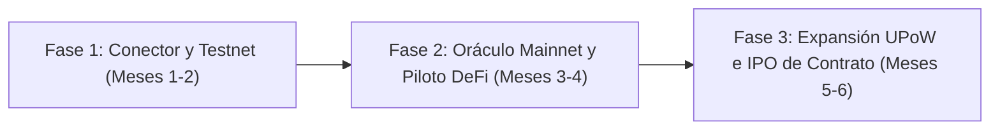

# Propuesta de Integración No Confidencial: IA Nativa Determinista y Qubic

**Documento Técnico y Estratégico para el Fondo de Incubación y Programa de Grants de Qubic**  
*Clasificación: Distribución Pública / No Confidencial (Protección Estricta de Propiedad Intelectual - Axioma I)*  
*Versión: 1.0 — Octubre 2026*  

---

## 1. Resumen Ejecutivo y Diagnóstico

La red **Qubic** representa la cúspide de la ingeniería de registros distribuidos de Alto Rendimiento (Layer 1):
* **Rendimiento:** 15.5 millones de transacciones por segundo (TPS).
* **Costes:** Transacciones completamente libres de comisiones (*feeless*).
* **Consenso:** 676 *Computors* con finalización instantánea por época.
* **Paradigma Energético:** Prueba de Trabajo Útil (**UPoW**), transformando la potencia computacional minera en entrenamiento de redes neuronales artificiales (ANNs) a través del protocolo **Aigarth**.

### El Muro Epistemológico y Termodinámico
Aigarth es un prototipo visionario. Sin embargo, basar la inteligencia artificial exclusivamente en arquitecturas neuronales probabilísticas colisiona contra dos límites estructurales fundamentales:
1. **El Muro de la Alucinación:** Los modelos estocásticos carecen de invariantes causales; su precisión es siempre probabilística ($\le 1 - \epsilon$), lo que los inhabilita para misiones críticas donde el fallo implica pérdida de capital o riesgo vital (DeFi de alta frecuencia, liquidaciones algorítmicas, auditoría médica o cumplimiento legal).
2. **El Muro Termodinámico:** El reentrenamiento continuo de ANNs para corregir errores puntuales exige un consumo exponencial de energía ($F > 0$) con rendimientos decrecientes.

### La Solución: Integración de Inferencia Determinista de Doble Capa
Esta propuesta articula la integración no invasiva de una **Capa de Inferencia Causal Determinista (Kernel Nivel 0 + Inferencia Activa $F \to 0$)** acoplada a Qubic como un **Oráculo Nativo de Decisión**. El resultado es dotar a los contratos inteligentes de Qubic de **$0.0\%$ de margen de alucinación**, latencia en silicio inferior a **$0.01\text{ ms}$** y verificación criptográfica SHA-256 instantánea.

---

## 2. Marco Teórico y Alineación Axiomática

La arquitectura se fundamenta en los 4 Axiomas de la *Teoría Unificada*:

| Axioma | Principio Cibernético | Aplicación en la Integración Qubic |
| :--- | :--- | :--- |
| **Axioma I: Soberanía de Membrana** | Un nodo soberano nunca expone su Kernel interno ni diluye su frontera operativa. | Integración como **Caja Negra / Búnker**. La propiedad intelectual del Kernel Nivel 0 permanece privada; solo se exponen interfaces y oráculos. |
| **Axioma II: Vector de Señal Incorruptible** | Los sistemas autónomos colapsan sin retroalimentación causal y determinista. | Dotar a Aigarth de canales de verificación con $0.0\%$ de alucinación y reglas *fail-closed*. |
| **Axioma III: Geodésica de Mínima Acción ($\delta S = 0$)** | Maximizar el rendimiento útil ($T$) minimizando el roce burocrático y computacional ($V \to 0$). | No se altera el consenso de los Computors; la integración se realiza vía llamadas RPC/gRPC nativas a velocidad de silicio. |
| **Axioma IV: Atractor NESS Sostenible** | Auto-sostenibilidad mediante generación negentrópica de flujo de valor. | Captura de capital no dilutivo (Grants) seguida del cobro de micro-tasas por validación y modelo de IPO en Qubic. |

---

## 3. Arquitectura del Sistema (Búnker Soberano / Caja Negra)

```
[ Contratos Inteligentes / dApps en Qubic ]
                     │  (Llamada Feeless / Micro-tasa)
                     ▼
┌────────────────────────────────────────────────────────┐
│   ORÁCULO DETERMINISTA NATIVO DE DOBLE CAPA            │
│                                                        │
│   ┌────────────────────────────────────────────────┐   │
│   │ Sistema 1: Inferencia Activa (F -> 0)          │   │
│   │ - Mapeo Bayesiano y Minimización de Sorpresa    │   │
│   │ - Pre-filtrado ultra-rápido en tiempo real     │   │
│   └───────────────────────┬────────────────────────┘   │
│                           │                            │
│                           ▼                            │
│   ┌────────────────────────────────────────────────┐   │
│   │ Sistema 2: Kernel Determinista Nivel 0         │   │
│   │ - Cortafuegos Cartesiano (Fail-Closed)         │   │
│   │ - Verificación Lógica 0.0% Alucinación         │   │
│   │ - Sellado Criptográfico SHA-256                │   │
│   └────────────────────────────────────────────────┘   │
└───────────────────────────┬────────────────────────────┘
                            │
                            ▼
      [ Salida Sellada: Decisión Determinista Válida ]
```

### Especificación de la Interfaz Externa
* **Protocolo de Comunicación:** gRPC / C-ABI de ultra-baja latencia sobre sockets UNIX o memoria compartida en nodos Computors.
* **Garantía de Tiempo de Respuesta:** $< 10\ \mu\text{s}$ ($0.01\text{ ms}$).
* **Comportamiento ante Incertidumbre:** Modo *Fail-Closed* (`VOID_AB_INITIO`). Si una entrada no cumple con la invariante causal requerida, el oráculo emite un veto determinista, impidiendo que el smart contract ejecute un estado inválido.

---

## 4. Cuatro Vectores de Impacto y Monetización en Qubic

### 1. Oráculo de Inferencia Determinista para dApps (SaaS B2B)
* **Objetivo:** Permitir a dApps de finanzas descentralizadas (DeFi), seguros paramétricos, auditoría de reclamos médicos y resolución legal automatizada ejecutar lógica de negocio sin riesgo de alucinación.
* **Mecanismo:** Cobro de micro-tasas denominadas en \$QUBIC o stablecoins por cada atestación causal firmada.

### 2. Optimización y Comercialización del Cómputo UPoW
* **Objetivo:** Expandir la utilidad del minado de Qubic más allá de redes neuronales genéricas.
* **Mecanismo:** Redirigir cuotas de cálculo UPoW hacia:
  * Verificación formal de código y demostración automática de teoremas en Lean 4.
  * Optimización combinatoria y dinámica biofísica mediante minimización de energía libre variacional ($F \to 0$).
  * Comercialización de esta potencia a laboratorios farmacéuticos e instituciones financieras.

### 3. Modelo de IPO de Smart Contracts en Qubic
* **Objetivo:** Emplear el sistema nativo de IPOs de Qubic para descentralizar los derechos de rendimiento del Oráculo.
* **Mecanismo:** Distribución de participaciones de ingresos generados por las micro-tasas del oráculo entre los poseedores de participaciones del contrato inteligente.

### 4. Captura de Capital No Dilutivo (Grants y Fondo de Incubación)
* **Objetivo:** Financiar la adaptación de la interfaz C/C++ y los bancos de pruebas en testnet mediante el programa de grants oficial del ecosistema Qubic (fondo de 200 mil millones de \$QUBIC).

---

## 5. Hoja de Ruta y Entregables del Grant



### Hitos de Ejecución:
* **Hito 1 (Meses 1 - 2): Adaptador C/C++ & Integración en Testnet**
  * Entrega del SDK de cliente para contratos Qubic.
  * Banco de pruebas demostrando latencia $< 0.01\text{ ms}$ y 0.0% alucinaciones sobre 1,000,000 de llamadas simuladas.
* **Hito 2 (Meses 3 - 4): Despliegue del Oráculo en Mainnet y Primer Caso de Uso**
  * Lanzamiento del servicio de oráculo para dApps del ecosistema.
  * Integración de prueba con una dApp de préstamos / derivados en Qubic para liquidaciones deterministas instantáneas.
* **Hito 3 (Meses 5 - 6): Integración UPoW y Lanzamiento de IPO de Smart Contract**
  * Especificación del sub-algoritmo de verificación formal para mineros UPoW.
  * Publicación de la IPO del Smart Contract del Oráculo bajo el mecanismo nativo de Qubic.

---

## 6. Blindaje de Propiedad Intelectual (Axioma I)

1. **Código Cerrado en Silicio:** El motor algebraico, los grafos de inferencia activa y las matrices de veto causal del Kernel Nivel 0 son distribuidos exclusivamente como ejecutables binarios precompilados u operados mediante endpoints seguros con atestación remota (Intel SGX / AMD SEV).
2. **Entregables Abiertos Limitados:** El código liberado bajo el grant comprende únicamente las interfaces abiertas (APIs, bindings en C++, smart contracts de invocación y especificaciones de llamada).
3. **Soberanía Garantizada:** Ninguna parte del acuerdo de subvención confiere derechos de propiedad intelectual sobre los algoritmos nucleares del desarrollador.

---

## 7. Conclusión y Llamado a la Acción

La unión entre el motor de ejecución ultra-rápido de Qubic y la arquitectura de verificación determinista crea una ventaja competitiva insuperable: **la primera blockchain con IA nativa matemáticamente inmune a las alucinaciones**. 

Invitamos al Comité de Grants y al Equipo de Liderazgo de Qubic a dar inicio a la evaluación técnica preliminar.
